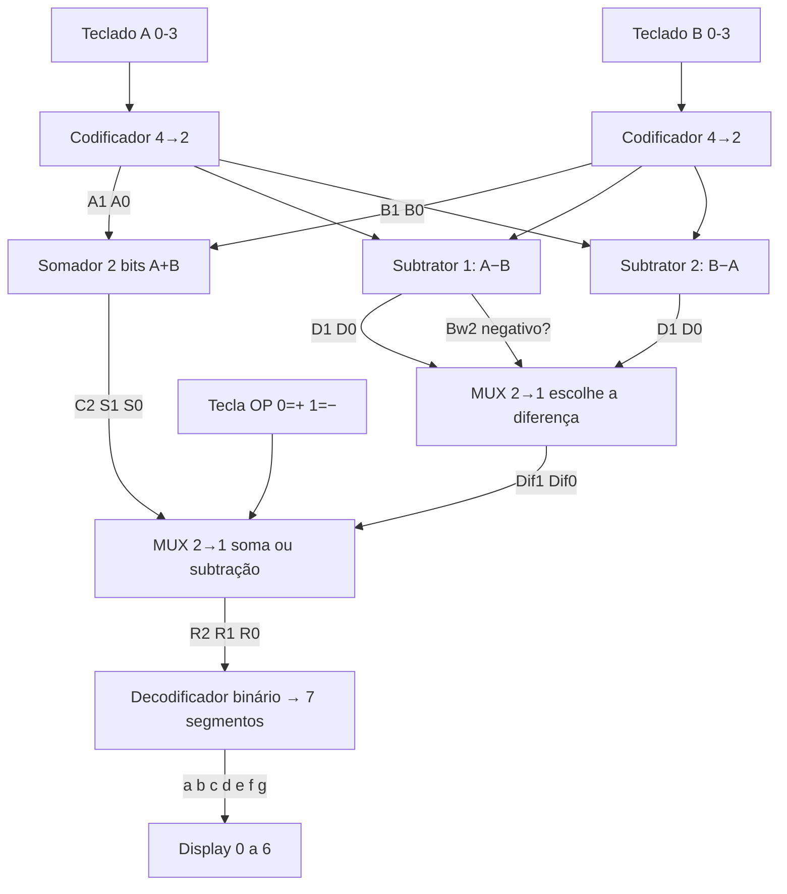
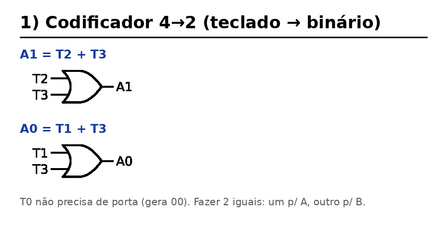
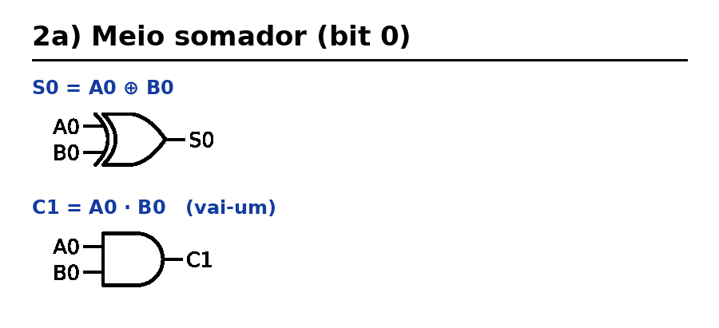
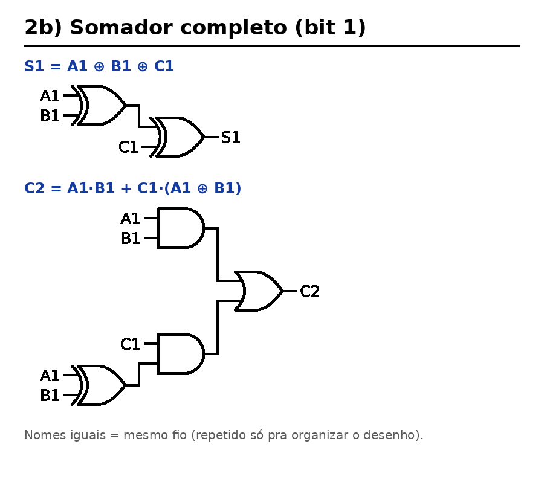
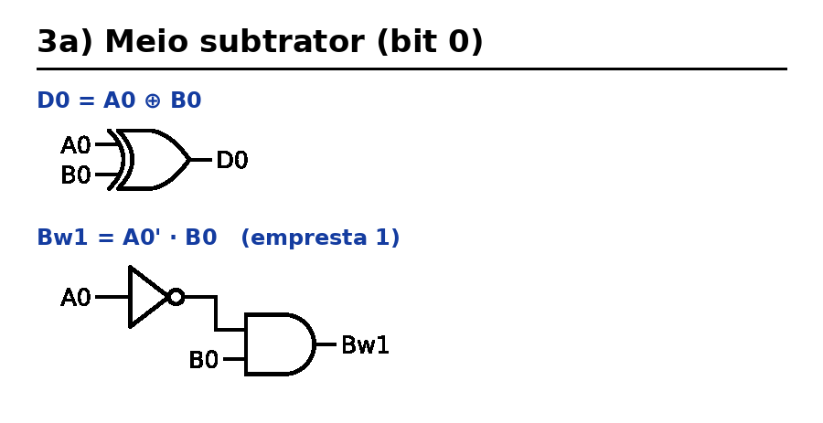
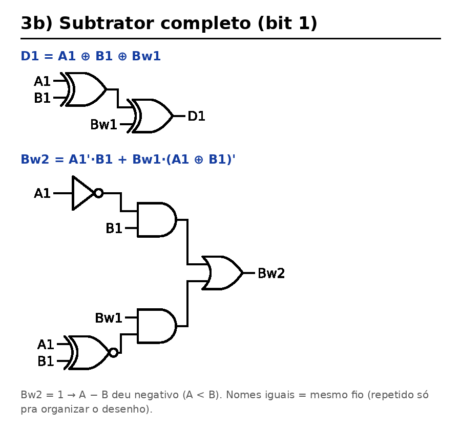
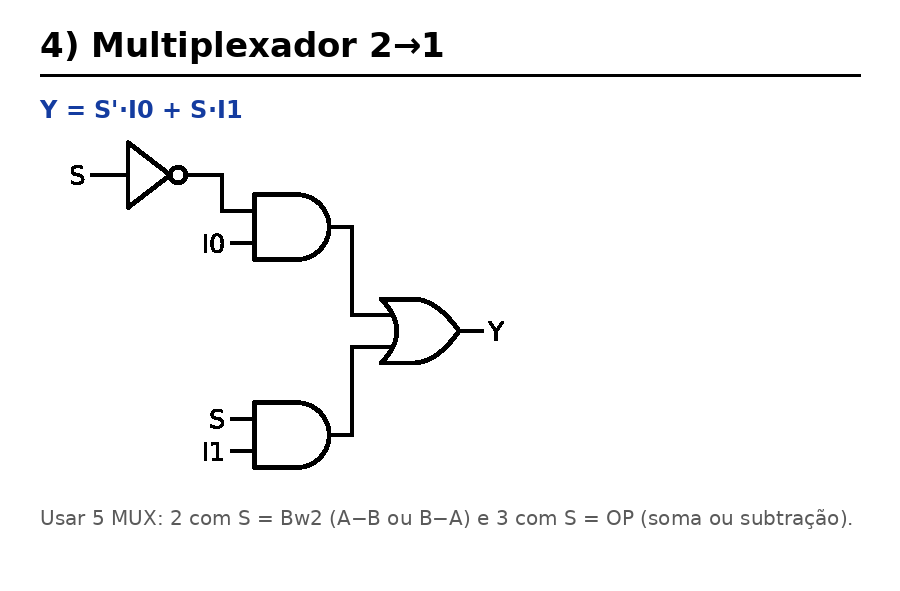
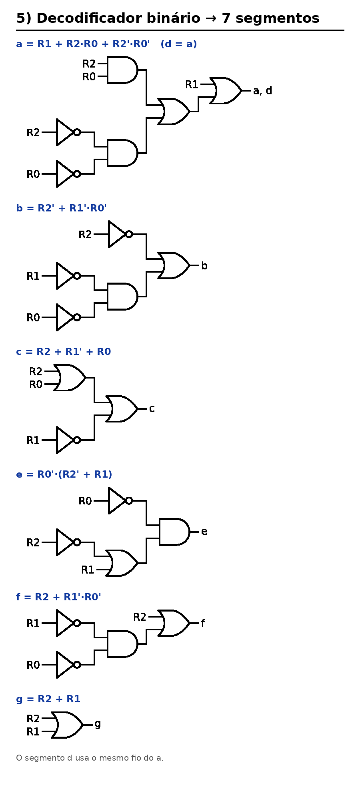
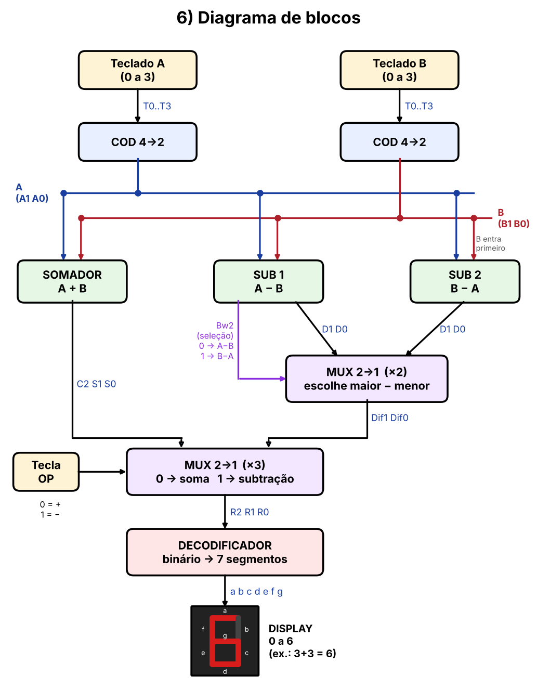

# Exercício: desafio de soma e subtração

> **Desafio)** Construa um sistema digital para somar e subtrair dois números vindos de um
> teclado que vai de zero a 3, e o resultado é apresentado em um display que vai de 0 a 6.
> Mostre os componentes (codificadores e multiplexadores e somadores e subtratores) nos seus
> detalhes (montar os circuitos internos em portas lógicas). E depois a ligação no diagrama
> de blocos. Lembre-se A + B = B + A, porém A − B ≠ B − A.

---

## 0) Análise do problema

| Decimal | Binário |
|:-:|:-:|
| 0 | 00 |
| 1 | 01 |
| 2 | 10 |
| 3 | 11 |

- Cada número (A e B) vai de **0 a 3**, então precisa de **2 bits**: A = A1 A0, B = B1 B0.
- **Soma:** o maior resultado é 3 + 3 = **6** = `110`, então a saída tem **3 bits** (R2 R1 R0).
- **Subtração:** A − B pode dar negativo (ex.: 1 − 3 = −2), mas o display **só mostra de 0 a 6**
  e não tem sinal de menos.
  Como **A − B ≠ B − A**, o circuito calcula as duas e **sempre usa o maior menos o menor**
  (|A − B|, de 0 a 3).
- Tecla de operação **OP**: `0 = soma`, `1 = subtração`.

---

## 1) Codificador 4 → 2 (teclado → binário)

O teclado tem 4 teclas (T0, T1, T2, T3) e só uma é apertada por vez.

| Tecla | T3 | T2 | T1 | T0 | A1 | A0 |
|:-:|:-:|:-:|:-:|:-:|:-:|:-:|
| 0 | 0 | 0 | 0 | 1 | 0 | 0 |
| 1 | 0 | 0 | 1 | 0 | 0 | 1 |
| 2 | 0 | 1 | 0 | 0 | 1 | 0 |
| 3 | 1 | 0 | 0 | 0 | 1 | 1 |

**A1 = T2 + T3**  **A0 = T1 + T3**

```
 T2 ─┐
     OR ──── A1
 T3 ─┘

 T1 ─┐
     OR ──── A0
 T3 ─┘
```
(A tecla T0 não precisa de porta: ela gera 00.)

São 2 portas OR. São usados **2 codificadores iguais**, um para o número A e outro para o B.

---

## 2) Somador de 2 bits

### Meio somador (bit 0)

| A0 | B0 | S0 | C1 |
|:-:|:-:|:-:|:-:|
| 0 | 0 | 0 | 0 |
| 0 | 1 | 1 | 0 |
| 1 | 0 | 1 | 0 |
| 1 | 1 | 0 | 1 |

**S0 = A0 ⊕ B0**  **C1 = A0 · B0**

```
 A0 ─┐
     XOR ──── S0
 B0 ─┘

 A0 ─┐
     AND ──── C1 (vai-um)
 B0 ─┘
```

### Somador completo (bit 1)

| A1 | B1 | C1 | S1 | C2 |
|:-:|:-:|:-:|:-:|:-:|
| 0 | 0 | 0 | 0 | 0 |
| 0 | 0 | 1 | 1 | 0 |
| 0 | 1 | 0 | 1 | 0 |
| 0 | 1 | 1 | 0 | 1 |
| 1 | 0 | 0 | 1 | 0 |
| 1 | 0 | 1 | 0 | 1 |
| 1 | 1 | 0 | 0 | 1 |
| 1 | 1 | 1 | 1 | 1 |

**S1 = A1 ⊕ B1 ⊕ C1**  **C2 = A1·B1 + C1·(A1 ⊕ B1)**

```
 A1 ─┐
     XOR1 ── X ─┬──────────┐
 B1 ─┘          │          XOR2 ────────── S1
 C1 ────────────┼──────────┘
                │
 X  ────────────┐
                AND1 ──┐
 C1 ────────────┘      OR ──────────────── C2
 A1 ─┐                 │
     AND2 ─────────────┘
 B1 ─┘
```
(X = A1 ⊕ B1 é usado nas duas partes.)

**Resultado da soma:** C2 S1 S0 (de 0 a 6). Exemplo: 3 + 3 → `11 + 11 = 110` = 6.

---

## 3) Subtrator de 2 bits

### Meio subtrator (bit 0)

| A0 | B0 | D0 | Bw1 |
|:-:|:-:|:-:|:-:|
| 0 | 0 | 0 | 0 |
| 0 | 1 | 1 | 1 |
| 1 | 0 | 1 | 0 |
| 1 | 1 | 0 | 0 |

**D0 = A0 ⊕ B0**  **Bw1 = A0' · B0** (Bw = "empresta 1")

```
 A0 ─┐
     XOR ──── D0
 B0 ─┘

 A0 ── NOT ── A0' ─┐
                   AND ──── Bw1
 B0 ───────────────┘
```

### Subtrator completo (bit 1)

| A1 | B1 | Bw1 | D1 | Bw2 |
|:-:|:-:|:-:|:-:|:-:|
| 0 | 0 | 0 | 0 | 0 |
| 0 | 0 | 1 | 1 | 1 |
| 0 | 1 | 0 | 1 | 1 |
| 0 | 1 | 1 | 0 | 1 |
| 1 | 0 | 0 | 1 | 0 |
| 1 | 0 | 1 | 0 | 0 |
| 1 | 1 | 0 | 0 | 0 |
| 1 | 1 | 1 | 1 | 1 |

**D1 = A1 ⊕ B1 ⊕ Bw1**  **Bw2 = A1'·B1 + Bw1·(A1 ⊕ B1)'**

```
 A1 ─┐
     XOR1 ── X ─┬──────────┐
 B1 ─┘          │          XOR2 ────────── D1
 Bw1 ───────────┼──────────┘
                │
 X ── NOT ── X' ┐
                AND1 ──┐
 Bw1 ───────────┘      OR ──────────────── Bw2
 A1 ── NOT ── A1'┐     │
                 AND2 ─┘
 B1 ─────────────┘
```
(X = A1 ⊕ B1.)

**Bw2 = 1 quer dizer que A − B ficou NEGATIVO (A < B).**

### Por que dois subtratores? (A − B ≠ B − A)

Na soma tanto faz a ordem (A + B = B + A), mas na subtração não. Exemplo: 3 − 1 = 2, mas
1 − 3 = −2, e o display não mostra negativo. Por isso:

- **SUB 1** calcula A − B e gera o **Bw2** (sinal de "deu negativo");
- **SUB 2** calcula B − A;
- um **MUX** usa o Bw2 para escolher: se Bw2 = 0 fica com A − B, se Bw2 = 1 fica com B − A.

O resultado é sempre o **maior menos o menor**, de 0 a 3.

---

## 4) Multiplexador 2 → 1

| S | Y |
|:-:|:-:|
| 0 | I0 |
| 1 | I1 |

**Y = S'·I0 + S·I1**

```
 S ── NOT ── S' ─┐
                 AND ──┐
 I0 ─────────────┘     │
                       OR ──── Y
 S ──────────────┐     │
                 AND ──┘
 I1 ─────────────┘
```

O sistema usa **5 MUX 2→1** (1 bit cada):

| MUX | Seleção | I0 | I1 | Saída |
|:-:|:-:|:-:|:-:|:-:|
| M1 | Bw2 | D0 (A−B) | D0 (B−A) | Dif0 |
| M2 | Bw2 | D1 (A−B) | D1 (B−A) | Dif1 |
| M3 | OP | S0 | Dif0 | R0 |
| M4 | OP | S1 | Dif1 | R1 |
| M5 | OP | C2 | 0 | R2 |

(O M5 simplifica para **R2 = OP' · C2**, porque a subtração nunca passa de 3.)

---

## 5) Decodificador binário → display de 7 segmentos (0 a 6)

```
   _a_
 f|   |b
   _g_
 e|   |c
   _d_
```

| Dec | R2 | R1 | R0 | a | b | c | d | e | f | g |
|:-:|:-:|:-:|:-:|:-:|:-:|:-:|:-:|:-:|:-:|:-:|
| 0 | 0 | 0 | 0 | 1 | 1 | 1 | 1 | 1 | 1 | 0 |
| 1 | 0 | 0 | 1 | 0 | 1 | 1 | 0 | 0 | 0 | 0 |
| 2 | 0 | 1 | 0 | 1 | 1 | 0 | 1 | 1 | 0 | 1 |
| 3 | 0 | 1 | 1 | 1 | 1 | 1 | 1 | 0 | 0 | 1 |
| 4 | 1 | 0 | 0 | 0 | 1 | 1 | 0 | 0 | 1 | 1 |
| 5 | 1 | 0 | 1 | 1 | 0 | 1 | 1 | 0 | 1 | 1 |
| 6 | 1 | 1 | 0 | 1 | 0 | 1 | 1 | 1 | 1 | 1 |
| 7 | 1 | 1 | 1 | X | X | X | X | X | X | X |

(O 7 nunca acontece, então é **X = irrelevante** e ajuda a simplificar no mapa de Karnaugh.)

Expressões simplificadas:

- **a = R1 + R2·R0 + R2'·R0'**
- **b = R2' + R1'·R0'**
- **c = R2 + R1' + R0**
- **d = a** (mesma expressão)
- **e = R0' · (R2' + R1)**
- **f = R2 + R1'·R0'**
- **g = R2 + R1**

---

## 6) Diagrama de blocos (ligação final)

```
                 ┌──────────┐ A1 A0
 Teclado A ─────►│ COD 4→2  ├──────┬──────────────┬──────────────┐
 (T0..T3)        └──────────┘      │              │              │
                                   ▼              ▼              ▼
                              ┌─────────┐   ┌──────────┐   ┌──────────┐
                              │ SOMADOR │   │  SUB 1   │   │  SUB 2   │
                              │  A + B  │   │  A − B   │   │  B − A   │
                              └────┬────┘   └──┬────┬──┘   └────┬─────┘
                                   ▲           │    │ Bw2       │
                 ┌──────────┐ B1 B0│           │    ▼           │
 Teclado B ─────►│ COD 4→2  ├──────┴───────────┘  ┌──────────┐  │
 (T0..T3)        └──────────┘   (vai p/ os 3)     │ MUX M1/M2│◄─┘
                                                  │ escolhe  │
                         C2 S1 S0                 │ maior−   │
                     ┌────────────────────┐       │ menor    │
                     │                    │       └────┬─────┘
                     ▼                    ▼ Dif1 Dif0  │
                  ┌─────────────────────────────┐      │
 Tecla OP ───────►│   MUX M3/M4/M5              │◄─────┘
 (0=+  1=−)       │   0 → soma   1 → subtração  │
                  └──────────────┬──────────────┘
                                 │ R2 R1 R0
                                 ▼
                       ┌───────────────────┐
                       │ DECODIFICADOR     │
                       │ binário → 7 seg   │
                       └─────────┬─────────┘
                                 │ a b c d e f g
                                 ▼
                           ┌───────────┐
                           │  DISPLAY  │
                           │   0 a 6   │
                           └───────────┘
```



---

## 7) Exemplos

| Conta | A | B | OP | Somador | A−B (Bw2) | B−A | Saída R2R1R0 | Display |
|:-:|:-:|:-:|:-:|:-:|:-:|:-:|:-:|:-:|
| 3 + 3 | 11 | 11 | 0 | 110 | – | – | 110 | **6** |
| 2 + 1 | 10 | 01 | 0 | 011 | – | – | 011 | **3** |
| 3 − 1 | 11 | 01 | 1 | – | 10 (Bw2=0) ✔ | – | 010 | **2** |
| 1 − 3 | 01 | 11 | 1 | – | 10 (Bw2=1) ✘ | 10 ✔ | 010 | **2** |
| 2 − 2 | 10 | 10 | 1 | – | 00 (Bw2=0) ✔ | – | 000 | **0** |

---

## 8) Lista de componentes

| Bloco | Qtd | Portas |
|---|:-:|---|
| Codificador 4→2 | 2 | 2 OR cada |
| Somador 2 bits (meio + completo) | 1 | 3 XOR, 3 AND, 1 OR |
| Subtrator 2 bits (meio + completo) | 2 | 3 XOR, 3 AND, 1 OR, 3 NOT cada |
| MUX 2→1 | 5 | 2 AND, 1 OR, 1 NOT cada |
| Decodificador 7 segmentos | 1 | ver expressões do item 5 |
| Display 7 segmentos | 1 | – |

**Conferido:** o arquivo [`simulador.py`](simulador.py) monta tudo só com portas lógicas e
testa as 32 combinações (16 somas + 16 subtrações). Todas dão certo no display.
Para rodar: `python3 simulador.py`

---

## Desenhos dos circuitos (para copiar)

| Bloco | Desenho |
|---|---|
| 1) Codificador 4→2 |  |
| 2a) Meio somador |  |
| 2b) Somador completo |  |
| 3a) Meio subtrator |  |
| 3b) Subtrator completo |  |
| 4) MUX 2→1 |  |
| 5) Decodificador 7 segmentos |  |
| 6) Diagrama de blocos |  |

Tudo junto em PDF: [`desenhos/desenhos.pdf`](desenhos/desenhos.pdf). Para gerar de novo: `python3 desenhar_circuitos.py`.
